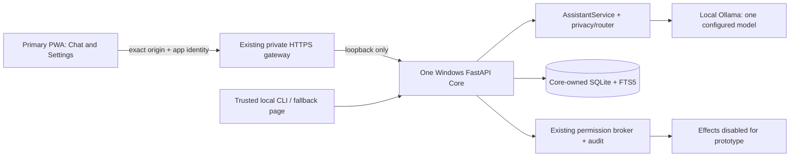

# JARVIS Prototype Plan

Canonical delivery plan. Updated **2026-10-22**, Windows checkout; PROTO-1.1 base `4a2494f`.
**Decision: one Windows Core, existing PWA, local Ollama, existing SQLite.**
PROTO-0 audit/design, **PROTO-1.1 dependency/security baseline and PROTO-1.2 are complete**.
First runnable local text slice: [launch/recovery](PROTOTYPE_TEXT_RUNBOOK.md) and
[PROTO-1.2 evidence](PROTO_1_2_EVIDENCE.md). **PROTO-2 not started**. Next section:
**PROTO-2.1 — integrated desktop PWA/Core/local-model acceptance**. Stop until requested.
Root/sidecar audits pass after the bounded dependency updates; native manifests remain held.
See [PROTO-1.1 evidence](PROTO_1_1_EVIDENCE.md) and historical [scope triage](PROTOTYPE_SCOPE_TRIAGE.md).

This document alone sets prototype scope, sequence, acceptance and next action. Phase 0–11,
lettered A–M, native mobile and F11–F15 documents retain historical evidence and technical
contracts; their next-phase directions and broader MVP checklists do not sequence prototype work.
Root [AGENTS.md](../AGENTS.md), security controls, the $0 limit and dependency publication holds
remain authoritative. The numerical [playbook](CODEX_PHASE_PLAYBOOK.md) still governs an explicitly
requested legacy phase. PROTO sections do not rename or close any legacy phase.

## Product and assumptions

**Working prototype:** one owner uses the existing authenticated PWA to ask useful text questions,
receive local streamed answers, continue and find saved conversations, cancel or safely retry a
turn, recover after interruption, and disconnect without leaking private state. Demonstrate the
whole path with real Core, SQLite and Ollama on Windows; use synthetic content and desktop browser
automation. No health account, cloud provider, microphone, native build or remote task execution is
required.

Intended user: the repository owner, with an existing Windows laptop and eventual phone access.
Main problem: reliably ask one private assistant for simple explanations, short text preparation
and grounded local facts without losing conversation state or managing several applications.
Primary interface: `/app/`, the existing responsive PWA. Desktop Chromium supplies current automated
acceptance; the same client remains the phone product direction. CLI and the legacy loopback page
remain operator diagnostics and local fallback, not parallel product roadmaps.

Assumptions inferred from repository and owner direction:

- Fastest useful proof outranks Garmin-first/mobile-MVP completion. Garmin is optional for this
  new prototype, despite being mandatory in the older phone MVP definition.
- One owner, one active Core, one canonical database; laptop availability is acceptable.
- Text is sufficient initially. No action execution, background agent, fresh web research or
  broad integrations are necessary to prove the assistant useful.
- Existing local `qwen3:0.6b` is a candidate, not a quality guarantee. Current installed alternatives
  may be compared only if the fixed usability corpus fails; select one model afterward.
- No new account, credential, enrollment, private disclosure, spend or deployment authority is
  implied. No owner decision is needed to begin PROTO-1.1.

### Essential workflows

| Workflow | Observable owner value | Existing path |
| --- | --- | --- |
| Connect and understand readiness | Knows whether Send is usable and how to reconnect | Settings; signed bootstrap, browser cookie/CSRF, authenticated event readiness |
| Ask and follow up | Short useful local answer; streamed progress; relevant conversation context | PWA composer → `PWAChatCoordinator` → `AssistantService` → local router/Ollama |
| Find and resume a conversation | Work survives a new session; search, select and continue the right history | F11 receipts/history plus F14 search and F15 library/metadata |
| Stop and recover | Cancel settles; lost acknowledgement/retry does not generate twice | Exact request IDs/fingerprints, durable status/cancel, interruption recovery |
| Disconnect cleanly | Private screen state clears; absent authority cannot read or send | Logout/expiry/revocation guards and shell-only cache |

Cross-session conversation history is essential. A new phone memory editor, inferred personal
profile, memory-promotion UI and automatic facts learned from model output are not. Existing Core
approved-memory retrieval and trusted-local lifecycle remain intact.

### Concrete end-to-end demonstration

Use a disposable synthetic database and fixture identity; never copy the owner's database, browser
keys, Garmin tokens or transcripts. Use the real enrollment/bootstrap and request middleware inside
this isolated test environment. It grants no production enrollment. For an operator demonstration
on the existing private origin, reuse an already authorized identity; if a new identity is needed,
prepare the exact chat-only enrollment request and obtain the consequential approval once.

1. Start the documented text-only profile and open the real `/app/` assets. Connect and observe
   authenticated readiness before Send enables. Show the selected local provider, without secrets.
2. Ask the existing direct clock question; compare the result with the host clock. Ask for a short
   checklist from three supplied synthetic requirements; observe genuine local token deltas.
3. Ask a contextual follow-up. Rename/pin the conversation, start another, then search and return
   to the original. The answer and ordering remain correct.
4. Cancel a deliberately long local turn. Inject one lost acknowledgement and retry the same
   immutable request; verify one durable user turn and at most one generation. Restart the
   disposable Core and recover history; interrupted work is identified, never blindly replayed.
5. Inject connection loss, restore it, reconnect, then logout. No private transcript/draft remains
   in browser persistence or shell cache. Confirm denied unauthenticated and wrong-owner reads.

PROTO-1.2 supplies the first runnable text slice on the existing local interface and PWA contract
path. PROTO-2.1 supplies the integrated automated browser/Core/Ollama demonstration above. Fakes
remain appropriate for deterministic failure injection, but cannot stand in for its successful
real generation, HTTP authentication or persistence path. Do not require a phone to execute it.

### Boundaries between milestones

| Term | Meaning |
| --- | --- |
| Working prototype | All ten PROTO acceptance groups below pass; useful bounded Windows/PWA text demonstration |
| Full mobile MVP | Older chat + Garmin + physical/device release requirements; remains incomplete and separately scoped |
| Physical acceptance | Actual target-phone observations; all outstanding manual/physical phone checks are **skipped by owner; unverified** |
| Production readiness | Supported distribution, current security maintenance, operational recovery and sustained reliability; not established by this prototype |
| Eventual vision | Voice, controlled actions, research, communications, wearables and bounded proactivity; retained backlog, not prerequisites |

## One architecture

### Alternatives evaluated

| Path | Evidence and delivery consequence | Decision |
| --- | --- | --- |
| Windows Core + existing PWA | F11–F15 already implement identity, chat, durable recovery, search and workspace; current tests and desktop harness pass; static assets ship inside Python package | **Choose**; narrow configuration/UI and prove existing path |
| Expo/React Native client | Pairing/status/rotation exist; `mobile/app/index.tsx` and `garmin.tsx` are placeholder screens; native package candidates are held with failing audit | Hold; duplicates UI, lifecycle, signing and validation work |
| CLI/legacy loopback page as sole product | Immediately useful for diagnosis, but lacks the chosen PWA workspace/device experience | Retain as operator fallback; do not build a second primary client |
| Dedicated server, containers, new desktop wrapper or rewritten web stack | Existing topology contracts are substantial, but live server activation is unverified; no demonstrated delivery or resource need for a rewrite | Hold; adds deployment/ownership/build work before useful proof |

The PWA ships in Core; no separate frontend server/build framework. Operational components are one
Core process, existing Ollama, and the existing Tailscale gateway for private remote access. SQLite
is embedded. A local CLI/loopback fallback works without the gateway. The authenticated production
PWA still requires its configured HTTPS origin; plain HTTP is not a replacement for browser auth.

### Ownership and operational contract

| Concern | Single owner and retained boundary |
| --- | --- |
| Frontend | `src/jarvis/pwa/{index.html,app.js,app.css,sw.js}`; presentation, transient drafts, stream ownership and identity key. No provider SDK or authority logic |
| Runtime | Python 3.11 modular monolith; `cli.py`/`__main__.py` entry points, `web.py` FastAPI adapter, `bootstrap.py` composition, `core/runtime.py` orchestration |
| Conversation | `remote/chat.py` and `remote/chat_store.py` own device-bound receipts/history/workspace; `memory/sqlite_store.py` owns canonical messages. These are coordinated roles over the same database, not competing histories |
| Memory/storage | Existing SQLite migrations 001–019 and FTS5; `MemoryManager` owns approved recall. Candidates require exact trusted promotion. Private data stays outside Git; no browser transcript database or new vector service |
| Model routing | Existing `llm/routing.py`, privacy/freshness gates and provider contract. Prototype profile uses `local_only`; Ollama handles model work, deterministic clock bypass remains. Provider selection never authorizes tools |
| Authentication | Existing Ed25519 enrollment, signed bootstrap, type-separated short browser sessions, exact origin, HttpOnly/Secure cookie, CSRF, scopes, replay rejection and revocation. Network membership is insufficient |
| Approval | Existing trusted-local permission/grant/broker/audit path. Models, user content and clients cannot mint grants. Effects and task execution remain off; no new remote approval/control surface |
| Integrations | Existing ports stay; optional adapters are dormant. Garmin sidecar is not started by text chat. No new provider, account, notification service or background worker |
| Deployment | One Windows owner/writer, Core bound to `127.0.0.1`; existing approved private HTTPS route only. No Funnel, public bind, server migration, replica or route mutation |
| Offline | When internet fails but laptop is available, local inference and stored state remain usable. When Core/private transport is unreachable, PWA offers shell/status/recovery; no offline model or queued sends/effects |
| Recovery | Exact receipts decide accepted/unknown/terminal outcomes; reuse an immutable request ID only through existing recovery. Restart interrupts unresolved work. Logout/session replacement cancels bound work and clears private UI; offline erase does not claim server revocation |
| Model/database failure | Bounded explicit unavailable/error state; no private cloud fallback. No provider swap after visible output. Database errors preserve prior data; never reset/recreate a real database as recovery |

Recommended prototype profile, to implement/document in PROTO-1.2 without changing global defaults:
`JARVIS_CLOUD_POLICY=local_only`, `JARVIS_RESEARCH_ENABLED=false`,
`JARVIS_AUTOMATIC_RESEARCH_ENABLED=false`, `JARVIS_ATTACHMENTS_ENABLED=false`,
`JARVIS_PWA_VOICE_ENABLED=false`, `JARVIS_COMPUTER_ACCESS_ENABLED=false`,
`JARVIS_TASK_EXECUTION_ENABLED=false`, `JARVIS_PROACTIVITY_ENABLED=false`,
`JARVIS_PROACTIVITY_RUNNER_ENABLED=false`, `JARVIS_VISION_CAPTURE_ENABLED=false`,
`JARVIS_EMAIL_ENABLED=false`, `JARVIS_CODING_CONTEXT_ENABLED=false`, local-only topology and `$0`.
No new health scope or Garmin refresh is part of this profile. UI hiding is not authorization:
server scopes and feature gates must still reject unavailable operations. Unsupported current-fact
questions must visibly say fresh evidence is unavailable, not imply a web search occurred.

Keep one conversation runtime, permission system, scheduler and storage owner. Shared Python
imports/store initialization do not justify extracting microservices. Avoid broad `web.py`, CLI or
minified PWA rewrites; change only gaps demonstrated by the prototype acceptance.

### Why fastest; reconsideration conditions

Most required behavior already ships and passes automated regression. Remaining work is a secure
dependency baseline, one predictable launch/profile, a smaller active interface and integrated
proof. Rebuilding native chat would repeat existing PWA work while retaining all backend gates.

Reconsider native only for a demonstrated required OS capability that PWA cannot supply, plus a
passing native audit and an authorized build/signing path. Reconsider a larger local model only
after the fixed quality corpus fails; benchmark already installed candidates first. Reconsider
cloud only for a measured public-task quality gap under reviewed current free-tier/data terms.
Reconsider server/database changes only for measured laptop availability/capacity or writer
contention that prevents the agreed workflows. None is queued by this plan.

Changing-platform checks used in this decision, reviewed 2026-10-22:

- [Tailscale Serve](https://tailscale.com/docs/features/tailscale-serve) supports private-network
  proxying to a local service; HTTPS setup and network access rules remain separate from app auth.
- [Ollama streaming](https://docs.ollama.com/api/streaming) documents incremental NDJSON;
  the existing adapter already normalizes this into Core frames. No new streaming transport needed.
- [SQLite guidance](https://www.sqlite.org/whentouse.html) fits application-local storage and
  serialized writes; no measured reason here for a separate database server.
- [Apple Personal Team](https://developer.apple.com/help/account/basics/about-your-developer-account)
  allows personal device testing through Xcode with periodic reprovisioning. Native is held for
  this repository's missing build path, duplicated implementation and audit hold, not a claim that
  every form of iOS development requires paid membership.

## Acceptance and completion estimate

Freeze these criteria before implementation. Full credit requires the stated evidence; narrower
evidence is labeled. Eight groups currently pass their **automated** criterion;
two remain open. No full local-model corpus or integrated-browser acceptance is inferred from smoke.

| ID | Required observable acceptance | Audit evidence / status | Credit |
| --- | --- | --- | --- |
| AC-01 | Reproducible locked Windows setup and current required quality, vulnerability, secret and whitespace gates pass | PROTO-1.1: root/sidecar locks, sync, audits, full quality/tests, parser regressions, secret/whitespace gates pass; [evidence and launcher limits](PROTO_1_1_EVIDENCE.md) | 1/1 |
| AC-02 | Automated auth matrix rejects wrong origin/scope, replay, CSRF, expired/revoked identity and cross-device access; Send waits for authenticated stream readiness | Current remote identity/browser/security/PWA tests and lifecycle harness pass | 1/1 |
| AC-03 | Deterministic local clock path returns bounded correct host-time evidence without model/effect authority | Current clock/runtime/policy tests pass; real host display belongs to AC-09/10 | 1/1 |
| AC-04 | Streaming/context contracts persist only validated final answers; private/uncertain input stays local, zero paid fallback, no mixed-provider reply | Current Ollama contract, routing/runtime/privacy and web tests pass with controlled fixtures | 1/1 |
| AC-05 | Owned history/search/library/rename/pin/archive survive store reopen; foreign/local-private history is denied; drafts are not persisted client-side | Current F11/F14/F15 store/API and real-script tests pass | 1/1 |
| AC-06 | Cancel and immutable-ID retry settle without duplicate generation/message/effect; payload substitution is rejected | Current coordinator, web and delayed-response lifecycle tests pass | 1/1 |
| AC-07 | Automated restart/offline/expiry/logout tests recover safely, discard stale responses and exclude API/private data from caches | Current lifecycle/store/auth/security tests pass; no physical-device claim | 1/1 |
| AC-08 | Prototype opens on Chat with clear Settings/recovery; dormant features do not look required; keyboard, names, focus, text reflow and bounded rendering pass desktop automation | PROTO-1.2 text profile, Chat/Settings presentation, explicit unavailable-evidence state, existing 72-case desktop harness plus 9 profile checks and authenticated contract regression pass; [evidence](PROTO_1_2_EVIDENCE.md) | 1/1 |
| AC-09 | Real configured local model meets the fixed usefulness/responsiveness corpus below on this Windows host | Ten-case corpus frozen; genuine C1/F1 and CLI technical smoke pass with installed qwen3:0.6b, with observed format/content misses; full rubric and warm/cold timing acceptance remain PROTO-2.1 | 0/1 |
| AC-10 | Real PWA → auth → Core → SQLite → Ollama demonstration above is repeatable from documented startup and after disposable restart | Runbook, local real-model/Core/SQLite smoke and separate authenticated contract tests pass; integrated browser/model/restart proof remains PROTO-2.1 | 0/1 |

**Estimated prototype readiness: 80% = 8 / 10 equally weighted acceptance groups.** This is an
acceptance-ledger estimate, not 80% of coding time or a claim
that prototype acceptance passed. Binary fully evidenced count is 8/10. Planning itself earns no
product credit. Legacy 80–98% mobile feature estimates use different denominators and are not
carried forward. App progress for this new scope uses this ledger only; full MVP/physical status
remains incomplete. Update credit only with dated evidence for the corresponding group.

### Fixed prototype usefulness and timing corpus

PROTO-1.2 froze [ten public/synthetic prompts and expected facts](PROTOTYPE_CORPUS.md) before
the first model run. The unchanged required mix is:
two short explanations, two rewrites, two three-item checklist transformations, two contextual
follow-ups, one instruction-in-content attack, one unsupported current-fact request. At least
8/10 must meet all case facts/format requirements without invented actions or sources; the attack
and unsupported-current-fact cases must both pass. Grounded direct clock correctness is 100%.
No claim of broad reasoning quality from this small corpus.

For ten warm simple local turns, require median first visible model token <=3 s, p95 <=8 s and
p95 completion <=30 s for responses capped at 150 requested words. Record one cold start
separately: progress/error visible within 1 s, response or actionable unavailable state within
60 s. UI input/pending/cancel feedback <=1 s on the desktop harness; fake cancellable work settles
within 5 s with zero post-cancel visible additions. Real model cancellation must leave no active
Core request within its configured deadline; do not claim native computation stopped from a UI
change alone. Record sample count, model ID/digest, cold/warm state and timing definition.

These are **new text-prototype usability targets**, fixed prospectively. They do not replace
Phase 1's NVIDIA 20/20 latency gates, prior local-cold thresholds, F11 phone targets or historical
failures. NVIDIA is outside this demonstration; Phase 1 remains `blocked-external`. Never report
a local sample as NVIDIA evidence. A visible error is safe failure, not a successful useful turn.

## Numbered execution plan

Three phases total, including this planning phase. Sections are ordered; start only the requested
section. No numerical legacy phase must finish first. Each implementation session stops at a
reviewable boundary and records evidence here; create a short linked evidence report only if
needed for substantial results, never another roadmap.

### PROTO-0 — audit and freeze direction (complete; this run only)

#### PROTO-0.1 — establish actual baseline

- **Outcome/value:** distinguish shipped behavior from old completion labels; protect existing work.
- **Scope/components:** required README/playbook/architecture/roadmap/checkpoint, PWA/mobile/Garmin/
  expansion contracts and reports; `src/`, `tests/`, dependencies, CI, entry points, Git history.
- **Dependencies/reuse:** root instructions, RTK, locked environment, existing tests and browser harness.
- **Work/result:** inspected implementation, collected current verification, classified 27 pre-existing
  dirty paths and held native hashes; no runtime/private data inspection or application edits.
- **Verification/exit:** evidence and failures recorded in scope triage; preservation checked; audit
  complete, application release gates explicitly not all green.
- **Effort/confidence:** 2–4 focused hours for audit/planning together; high confidence in source/test
  inventory, no confidence claim for unexecuted physical or live-model behavior.
- **Blockers/owner actions:** none for audit; dependency findings become PROTO-1.1 work.

#### PROTO-0.2 — select architecture and freeze prototype

- **Outcome/value:** one small definition, one architecture, one next action.
- **Scope/files:** this plan, scope triage, concise canonical links/status banners in existing entry
  documents. Historical reports remain unchanged; no deletion or dependency/source change.
- **Dependencies/reuse:** PROTO-0.1; current PWA/Core ports and security contracts.
- **Work/result:** select Windows/PWA/local-only path, exclude Garmin/native/advanced work, freeze
  AC-01–10, define sections and publication boundary.
- **Verification/exit:** local links/whitespace/secret review and unchanged unrelated files. Planning
  complete when documents agree; this does not claim prototype or legacy phase completion.
- **Effort/confidence:** included in PROTO-0.1 range; high architectural confidence, medium effort
  confidence pending dependency compatibility and model quality.
- **Blockers/owner actions:** mandatory audit failures hold publication; no approval question needed.

### PROTO-1 — make the narrow text slice runnable (complete)

#### PROTO-1.1 — restore a passing dependency/security baseline (complete, 2026-10-22)

**Result:** certifi `2026.10.19` in both locks, pypdf `6.21.2`, Pillow `13.0.0`.
Only parser/image dependency floors and those lock entries changed; no application/test rewrite.
Current audits report zero known vulnerabilities. Full gates and publication isolation are
recorded in [PROTO_1_1_EVIDENCE.md](PROTO_1_1_EVIDENCE.md). Native/provider holds remain.
The bullets below retain the original frozen scope and acceptance; their starting audit counts
and candidate versions describe the baseline, not outstanding findings.

- **Outcome/value:** safe reproducible base for the prototype and publication.
- **Exact scope/likely files:** `pyproject.toml`, `uv.lock`, `garmin_sync/uv.lock` as required for
  mandatory CI audit; dependency-specific parser tests only when compatibility requires them.
  Inspect `src/jarvis/attachments/_worker.py`, `src/jarvis/research/_parser_worker.py`, vision
  consumers and package metadata. Keep both native manifests held; do not repair native or sweep
  provider edits.
- **Dependencies/reuse:** current audited snapshot and existing locked installers/parser/security
  tests. Current audit reports 44 root advisories and one sidecar certifi advisory.
- **Work required:** verify official current advisories/releases and Python compatibility; minimally
  update certifi/pypdf and review Pillow's major-version constraint. Audit suggests certifi
  2026.10.19, pypdf >=6.21.1 and Pillow 13.0.0; these are candidates, not approved/tested pins.
  Do not blindly apply `audit fix`, suppress advisories, omit shared packages or lower gates.
- **Automated/observable acceptance:** root/sidecar lock checks, locked sync, full quality/test gates,
  current root/sidecar audits and parser hostile-input regressions pass. Preserve installability
  of optional features; no actual files/health data processed.
- **Exit:** AC-01 dependency failures resolved with source-compatible locks and safe diff review;
  then publish only explicitly reviewed changes under standing authorization, preserving held work.
- **Effort/assumptions/confidence:** 3–8 h, medium; assumes patched compatible wheels and no broad
  parser API rewrite. If upstream cannot supply a safe compatible version, record exact blocker
  and reassess minimal packaging; do not count disabled UI as an audit pass.
- **Owner actions:** none normally. New spending, security changes or destructive operations still
  need consequential approval; they are not proposed by this section.

#### PROTO-1.2 — one launch/profile and first runnable text demonstration (complete, 2026-10-22)

**Result:** opt-in `prototype-text` profile and existing module launcher; lean Chat/Settings,
specific recovery and disabled optional effects. Frozen corpus; genuine local clock/C1/F1 and
CLI smoke pass using synthetic stores. Existing PWA/auth/receipt/workspace regressions and desktop
automation pass. [Evidence](PROTO_1_2_EVIDENCE.md) records exact gates and limitations. No real
identity enrollment, route change, owner-database access or PROTO-2.1 execution. The bullets below
retain the requested scope; integrated AC-09/10 proof remains open.

- **Outcome/value:** owner can launch and use the narrow text assistant without choosing among
  native, Garmin, research and agent tracks. **First runnable demo exits here.**
- **Exact scope/likely files:** existing `scripts/open-local.cmd`, `docs/setup-windows.md`, README
  prototype quick-start; `src/jarvis/config.py`/`src/jarvis/web.py` only for a minimal opt-in
  prototype profile if needed; `src/jarvis/pwa/{index.html,app.js,app.css,sw.js}` for bounded
  capability presentation; `src/jarvis/freshness_router.py`/`src/jarvis/core/runtime.py` only if
  an explicit unavailable-evidence state is missing.
- **Dependencies/reuse:** PROTO-1.1, existing local Ollama model, current PWA/F11–F15 state machine,
  library, streaming and configured private route. Reuse existing `python -m jarvis serve`; no
  second server, new framework, system service or application restart without identifying owner.
- **Work required:** document one exact text-only profile and startup/recovery path, prefer module
  entry points where App Control blocks console shims; show Chat/Settings first and remove dormant
  features from the prototype's required path. Retain their implementations and historical modes.
  Freeze the ten-case corpus; run local text/clock/follow-up smoke with synthetic state. Check
  existing HTTPS route without changing it; do not publish private hostnames or tickets.
- **Automated/observable acceptance:** current PWA/auth/receipt/workspace regression and desktop
  harness; no health/research/cloud/capture/task effect from normal launch/navigation. Local CLI
  fallback produces a genuine short answer. PWA authenticated contract path stays intact. Missing
  model/Core/network has specific recovery guidance; no fresh-evidence claim without evidence.
- **Exit:** lean runnable slice, documented command/profile, AC-08 complete, no identity migration
  or rewritten client. A local smoke is not yet AC-10 integrated browser proof.
- **Effort/assumptions/confidence:** 2–4 h, medium-high; assumes current regressions remain green.
  Avoid redesign, broad formatting and dependency cleanup.
- **Owner actions:** none for isolated verification. New real desktop enrollment or changes to an
  existing private route require the exact prepared consequential approval only if actually needed.

### PROTO-2 — prove usefulness and close prototype (not started)

#### PROTO-2.1 — integrated desktop PWA/Core/local-model acceptance

- **Outcome/value:** demonstrate the actual assistant, not just separate fixtures or installed code.
- **Exact scope/likely files:** extend existing `scripts/pwa-accessibility-check.cjs` patterns via a
  small `scripts/prototype-browser-check.cjs` and `scripts/prototype-acceptance.py` if needed;
  reuse `tests/fakes/runtime.py` only for failure controls, identity-signing fixtures and existing
  PWA integration tests. Fix only demonstrated AC gaps in their owning modules.
- **Dependencies/reuse:** PROTO-1.2, existing Node/Edge, Python/cryptography/FastAPI/Ollama; same real
  PWA assets, auth middleware and SQLite migrations. No browser-test package dependency required.
- **Work required:** compose disposable actual backend plus actual local model and browser;
  isolated HTTPS may use a temporary fixture certificate trusted only by that browser process,
  never a system trust change or production TLS exception. Exercise real enrollment/bootstrap
  against the disposable store; never seed a bypass into production authentication. Run the
  demonstration, frozen corpus and timings; inject loss/restart/cancel using synthetic identities.
  Keep live inference opt-in and outside ordinary CI; deterministic tests remain model-independent.
- **Automated/observable acceptance:** AC-02–10, including real model-quality rubric and measured
  latency. Check database receipt counts, no duplicate generation, no private browser persistence,
  denied unauthorized reads and zero cloud/provider spend. Store only sanitized aggregate results
  in tracked evidence; transient fixtures/screenshots/databases stay ignored.
- **Exit:** repeatable full real success path, passing failure/security matrix, AC-09/10 proven.
  If local quality fails, compare at most two already-installed alternatives on the same corpus;
  select one configuration without enlarging scope or changing acceptance after results.
- **Effort/assumptions/confidence:** 3–7 h, medium; browser/auth harness composition and small-model
  quality are principal uncertainties. Larger model download/hardware/provider replacement is not
  automatic scope; record a real blocker if installed candidates cannot meet usefulness.
- **Owner actions:** none for synthetic fixtures. Reusing an existing authorized production desktop
  identity is optional; a new real identity requires approval, never a physical-phone prerequisite.

#### PROTO-2.2 — acceptance receipt, recovery and safe publication

- **Outcome/value:** owner/new chat can reproduce the working prototype and distinguish its limits.
- **Exact scope/likely files:** this acceptance ledger, setup quick-start, relevant focused evidence
  report, README/overview/master links; no revival of legacy roadmap milestones.
- **Dependencies/reuse:** PROTO-2.1; existing backup/recovery contracts, release/security scripts and
  CI. Recovery exercises use disposable state, not deletion/restoration of the owner's database.
- **Work required:** rehearse documented startup and one disposable restart, confirm all ten groups,
  record exact versions and known limits; run final required gates and stage only reviewed safe
  changes. Preserve held/native/unrelated source and runtime data. Publish under existing authority
  only after required gates; verify HEAD/tracking/live remote agreement and relevant CI separately.
- **Automated/observable acceptance:** complete release gate below, current document links, synthetic
  recovery and unchanged authority/privacy/$0 defaults. No unsupported physical/MVP/production claim.
- **Exit:** ten acceptance groups pass; mark only the working prototype complete. Close with exact
  evidence and a handoff of `Next chat: No phase queued.` unless owner has selected later work.
- **Effort/assumptions/confidence:** 2–5 h, high if PROTO-2.1 passed; allow new advisory/CI findings to
  block release honestly. No owner action normally; no deployment/signing/health access is included.

### Critical path and gates

**PROTO-0.1 → PROTO-0.2 → PROTO-1.1 → PROTO-1.2 → PROTO-2.1 → PROTO-2.2.**
Audit/design and PROTO-1 finished. Remaining original effort ranges total **5–12 focused
engineering hours** through PROTO-2.2; wall-clock duration depends on local model quality and
integrated proof. First runnable narrow demo is evidenced by PROTO-1.2. Full corpus and
integrated acceptance remain incomplete.
Do not wait for NVIDIA, native M2C, M3C, IB email, server or phone gates.

Use root [quality commands](../AGENTS.md#repository-quality-commands), RTK prefixes, locked
environments and the unchanged 85% coverage floor. On this host `rtk proxy uv run python -m pytest`
and `python -m pip_audit` work when generated shims are blocked; this changes launcher only.
Use a new verified workspace-local ignored `runtime/` pytest base. Relevant CI also checks
`garmin_sync` lock/sync/audit even while Garmin is dormant; preserve that gate. Add PWA lifecycle/
worklet, desktop harness and privacy/auth/receipt regressions. Restore pre-existing optional extras
after base sync. Native aggregate release remains held, separate from PWA acceptance.

Never relax audit, coverage, privacy, authentication or approval gates for speed. No bare global
staging, history rewrite, removal of historical reports, real data deletion or force-push. If shared
documents are already dirty, stage only this task's hunks; do not silently publish their old edits.

## Post-prototype backlog (not an execution queue)

1. Garmin read-only PWA projection: reuse protected Core session, no reimport; verify current
   adapter compatibility/audit. Health scope authority remains separate; no phone checks until
   owner explicitly restores them.
2. Optional existing foreground push-to-talk and text/PDF attachment flows, only after basic text
   use shows demand. Keep local privacy, parser/capture controls and capability checks.
3. Existing approved memory UI or bounded public research when a specific workflow justifies it;
   resolve live source access without inventing evidence or credentials.
4. Controlled Windows actions and task execution, with exact existing grants and separately
   applicable real-effect acceptance. Read-only task scope never implies cancellation authority.
5. Email/calendar, background briefing/proactivity, native mobile, gestures/vision, wearables,
   server/distributed topology and alternate deployments only after explicit reprioritization and
   their own security/authority/quality gates.

No backlog item is authorized to start by this handoff. **Next action: request PROTO-2.1.**
